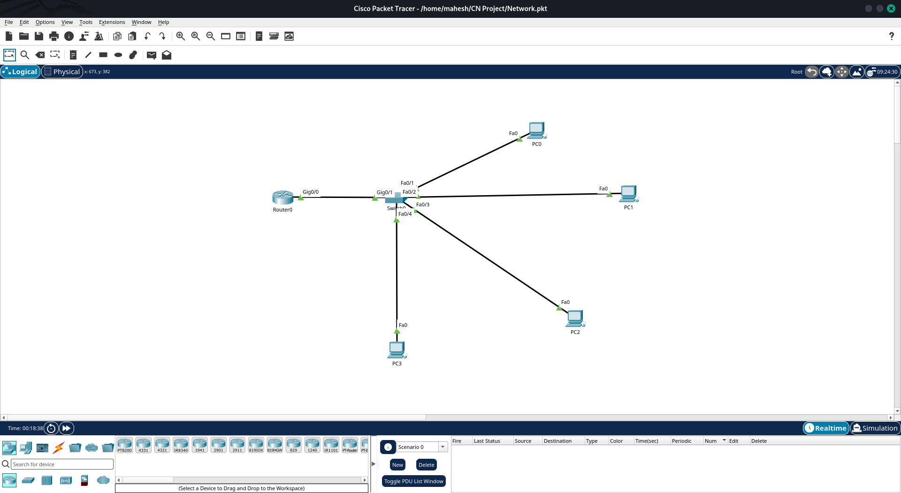

# VLAN Network with Inter-VLAN Routing, DHCP, ACL and SSH

A small office network built in Cisco Packet Tracer with two departments (Sales and IT) separated by VLANs. The router handles routing between them, assigns IP addresses automatically, restricts traffic with an ACL, and is managed securely over SSH.

## Topology


**Devices:** 1 router (R1), 1 Cisco 2960 switch, 4 PCs (2 in Sales, 2 in IT)

## What I Built
- 2 VLANs (10 Sales, 20 IT) on a Cisco 2960 switch
- Access ports assigned to each VLAN (Fa0/1-2 to VLAN 10, Fa0/3-4 to VLAN 20)
- Trunk link from the switch to the router (Gi0/1)
- Router-on-a-stick inter-VLAN routing using two subinterfaces (Gi0/0.10 and Gi0/0.20)
- DHCP pools on the router for both VLANs, with the first 10 addresses excluded
- Extended ACL that blocks Sales from reaching IT while allowing all other traffic
- SSH version 2 enabled on the router, with Telnet disabled on the VTY lines

## IP Plan
See [ip-table.md](ip-table.md)

| VLAN | Name | Network | Gateway |
|------|------|---------|---------|
| 10 | Sales | 192.168.10.0/24 | 192.168.10.1 |
| 20 | IT | 192.168.20.0/24 | 192.168.20.1 |

## Testing
| Test | Result |
|------|--------|
| PCs receive IP addresses through DHCP | Success |
| Ping within the same VLAN | Success |
| Ping between VLANs (before ACL) | Success |
| Ping from Sales to IT (after ACL) | Blocked by ACL |
| Ping from IT to Sales (after ACL) | Failed, because the reply is blocked by the ACL |
| SSH from PC0 to R1 | Success |

Screenshots are in the `screenshots` folder.

## Key Commands Used
```
show vlan brief
show interfaces trunk
show ip interface brief
show access-lists
show ip ssh
show running-config
```

## Problems I Faced and How I Fixed Them
1. **SSH key generation failed.** `crypto key generate rsa modulus 1024` was rejected in Packet Tracer, and `ip ssh version 2` then complained that no RSA keys existed. I used `crypto key generate rsa` instead and entered 1024 when prompted. After that SSH v2 worked.
2. **IT could not ping Sales even though the ACL only mentioned Sales to IT.** The ping from IT reached the Sales PC, but the reply was blocked as it passed back through the ACL on Gi0/0.10. I learned that an ACL affects return traffic too, so one-way rules can break two-way communication.

## Files
- `vlan-lab.pkt`: Packet Tracer project
- `router-config.txt`, `switch-config.txt`: device configurations
- `topology.png`: network diagram
- `ip-table.md`: IP addressing table
- `screenshots/`: proof of testing

## What I Learned
- **VLANs** split one physical switch into separate logical networks, so Sales and IT are isolated at Layer 2 even though they share the same hardware. This improves security and reduces broadcast traffic.
- **Trunking** lets a single cable carry traffic for several VLANs by tagging frames with 802.1Q. Without the trunk, the router could only see one VLAN.
- **Router-on-a-stick** uses one physical router port divided into subinterfaces, each acting as the default gateway for one VLAN. Devices in different VLANs cannot communicate without a Layer 3 device like this.
- **DHCP** on the router removes the need to configure every PC by hand. Excluding the first addresses keeps them free for gateways and servers.
- **ACLs** are read from top to bottom and end with an implicit deny, so the `permit ip any any` line is needed to avoid blocking everything else. Where the ACL is applied (and in which direction) decides what it affects, and it can break return traffic.
- **SSH** encrypts remote management, unlike Telnet, which sends passwords in plain text. It needs a hostname, a domain name, and RSA keys before it works.
- Troubleshooting with `show` commands, `ping`, and reading error messages carefully is as important as typing the configuration.

## Next Steps
- Add NAT so the internal network can reach the internet
- Add a second router and connect the two with OSPF
- Add port security on the switch access ports
